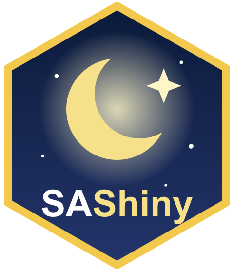

# SAShiny 

*Your SAS and Shiny programs, radiant as the moon.*

Use an **unchanged SAS program** as the **server** of a Shiny app, with Shiny (R or Python) handling the UI.
A sidecar YAML contract declares the program's inputs and outputs, and SAShiny does the rest.

> Status: beta (R 0.2.0, Python 0.2.0). See [PLAN.md](PLAN.md).
>
> **Licensed SAS only.** Programs run only on a live **SAS 9.4**, **SAS Viya** or **SAS ODA
> (OnDemand for Academics)** system; SAShiny does not provide SAS. There is no offline mode. You are responsible for holding a
> valid licence for that system, and you must acknowledge this before a run
> (`license_ack=TRUE`/`True`, `options(SAShiny.license_ack = TRUE)` or
> `SASHINY_LICENSE_ACK=true`). Automated checks (CRAN, PyPI, CI) use an internal test
> fixture that users cannot reach. Live verification is tracked in
> [#11](https://github.com/procogia/SAShiny/issues/11).
>
> **Posit Connect.** You can deploy apps with `sas_publish()` (R), `sashiny.publish()` (Python), the
> RStudio/Positron addin, or the opt-in "Publish" tab. Credential files are never bundled.

```
analysis.sas            # your SAS program — never modified
analysis.sashiny.yml    # the contract: inputs → macro variables, outputs → tables/plots/log/downloads
```

| Folder | Contents |
|---|---|
| [`R/`](R) | R package (target: CRAN) |
| [`Python/`](Python) | Python library (target: PyPI) |
| [`spec/`](spec) | The contract: [CONTRACT.md](spec/CONTRACT.md), [JSON Schema](spec/sashiny.schema.json), conformance fixtures |
| [`examples/`](examples) | Demo programs: general (`sashelp.cars`), pharma (TEAE summary), AML (threshold tuning), forecasting (ARIMA / SARIMA), survival (Kaplan-Meier / Cox) |

## The name

SAShiny is **SAS + Shiny**, and it is pronounced like **Sashini** (/sa-SHEE-nee/). Sashini is a South
Asian feminine given name from the Sanskrit *śaśin* (शशिन्), "moon": it means "moon",
"moon-like" or "radiant as the moon", and in Sinhalese also "charming" or "graceful"
([names.org](https://www.names.org/n/sashini/about)). SAS does the analysis; the Shiny half is the
moonlight that makes it shine.

## Development

```sh
# contract fixtures
uv run --no-project --python 3.12 --with jsonschema --with pyyaml python spec/tools/check_spec.py
# R package
R CMD build R && R CMD check --as-cran SAShiny_*.tar.gz
# Python library
cd Python && uv sync && uv run ruff check . && uv run mypy && uv run pytest
```

See [CONTRIBUTING.md](CONTRIBUTING.md).

## Maintainers

- Mehar Pratap Singh (author, maintainer)
- Shreya Sharma
- Love ProCogia
- Igor ProCogia
- Ahmer Khan

See [docs/HANDOFF.md](docs/HANDOFF.md) for the current state and the path to CRAN/PyPI.

## License

MIT © 2026 Mehar Pratap Singh. Development funded by ProCogia.

---
SAS is a registered trademark of SAS Institute Inc. Shiny is a registered trademark of Posit Software, PBC.
This project is not affiliated with or endorsed by either company.
